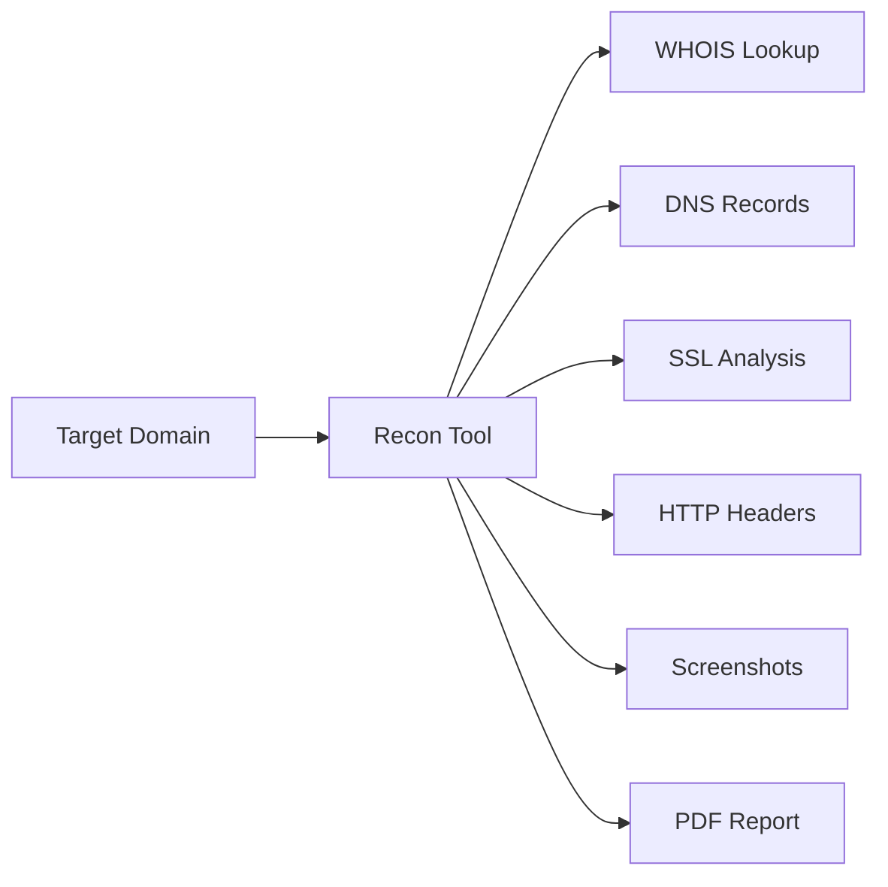

# 🔒 Automatic Recon Tool

<div align="center">


**Automated Cybersecurity Reconnaissance Tool**

[]()
[](https://github.com/samalarakshithbabu/automatic-recon-tool/issues)

</div>

---

## 🚀 Executive Summary

An **automated reconnaissance tool** built in Python with a user-friendly GUI for cybersecurity analysis and reporting. Gathers WHOIS, DNS, SSL, HTTP headers, metadata, and more. Generates PDF reports and captures screenshots.

### What It Does



---

## ✨ Key Features

| Feature | Description |
|---------|-------------|
| **WHOIS & DNS** | Domain registration and DNS enumeration |
| **HTTP Header Inspection** | Analyze response headers |
| **SSL Certificate Details** | Certificate chain and validity |
| **Shodan Integration** | Optional API integration |
| **Technology Detection** | BuiltWith integration |
| **Admin Panel Finder** | Common path discovery |
| **Screenshot Capture** | Selenium-based page screenshots |
| **PDF Export** | Structured report generation |
| **Email Support** | Send results via email |

---

## 🛠️ Technology Stack

| Component | Technology |
|-----------|------------|
| **Language** | Python 3 |
| **GUI** | Tkinter |
| **Web Scraping** | Selenium, requests |
| **PDF Export** | ReportLab / FPDF |
| **Email** | smtplib |
| **Optional APIs** | Shodan, BuiltWith |

---

## 📁 Project Structure

```
Automatic-Recon-Tool/
├── 2.py              # Main application (GUI + recon logic)
├── 2.spec            # PyInstaller spec file
├── LICENSE
└── README.md
```

---

## 🛠️ Installation

### Prerequisites
- Python 3.8+
- pip

### Setup
```bash
pip install -r requirements.txt
python 2.py
```

**Note:** Shodan integration requires a valid API key via environment variable.

---

## ⚠️ Limitations

| Limitation | Description |
|------------|-------------|
| **API Keys** | Shodan/BuiltWith require valid keys |
| **Admin Finder** | Uses common paths (not comprehensive) |
| **Screenshots** | Requires Selenium WebDriver |

---

## 📄 License

This project is licensed under the MIT License.

---

## 👨‍💻 Author

**SAMALA RAKSHITH BABU**

- 📧 Email: samalarakshithbabu7@gmail.com
- 💼 LinkedIn: [samala-rakshith-babu](https://www.linkedin.com/in/samala-rakshith-babu/)
- 🐙 GitHub: [samalarakshithbabu](https://github.com/samalarakshithbabu)